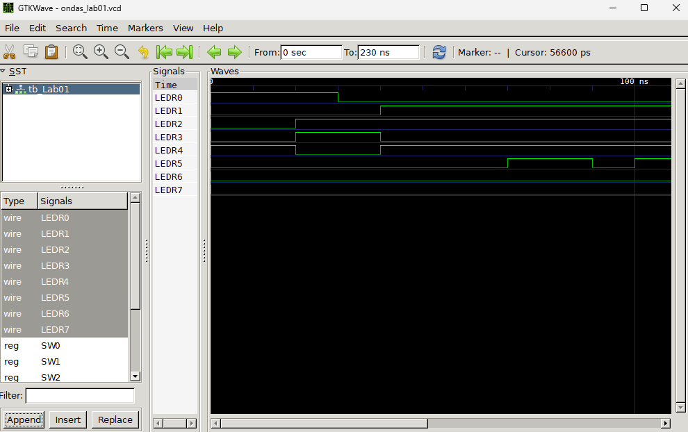

# Técnicas Digitales — Grupo 1, Equipo 4

> **Asignatura:** Técnicas Digitales | **Grupo:** 1 | **Equipo:** 4

## 👥 Integrantes

| Nombre | Rol |
|--------|-----|
| Diego Pineda | Integrante |
| Daniel Moyano | Integrante |
| Andrés Mejía | Integrante |

---

## 🔬 Laboratorio 01 — Compuertas Lógicas, Detector de Primos y Sumador Completo

### 📋 Descripción
Implementación en **Verilog** de tres circuitos combinacionales usando compuertas lógicas primitivas a nivel de compuerta (gate-level), con simulación en **Icarus Verilog** y visualización de formas de onda en **GTKWave**.

### 📁 Archivos

| Archivo | Descripción |
|---------|-------------|
| `Lab01.v` | Módulo principal con los tres circuitos |
| `tb_Lab01.v` | Testbench de simulación |
| `simulacion_gtkwave.png` | Captura de la simulación en GTKWave |

---

## ⚙️ Parte 1 — Compuertas Lógicas Básicas

**Entradas:** `SW0`, `SW1`

| Salida | Compuerta | Expresión Booleana |
|--------|-----------|-------------------|
| `LEDR0` | NOT | `¬SW0` |
| `LEDR1` | AND | `SW0 · SW1` |
| `LEDR2` | OR | `SW0 + SW1` |
| `LEDR3` | XOR | `SW0 ⊕ SW1` |
| `LEDR4` | XNOR | `¬(SW0 ⊕ SW1)` |

**Tabla de verdad (SW0, SW1):**

| SW0 | SW1 | LEDR0(NOT) | LEDR1(AND) | LEDR2(OR) | LEDR3(XOR) | LEDR4(XNOR) |
|-----|-----|-----------|-----------|----------|-----------|------------|
|  0  |  0  |     1     |     0     |     0    |     0     |      1     |
|  0  |  1  |     1     |     0     |     1    |     1     |      0     |
|  1  |  0  |     0     |     0     |     1    |     1     |      0     |
|  1  |  1  |     0     |     1     |     1    |     0     |      1     |

---

## 🔢 Parte 2 — Detector de Números Primos (3 bits)

**Entradas:** `SW2` (MSB, peso 4) · `SW3` (peso 2) · `SW4` (LSB, peso 1)
**Salida:** `LEDR5` → 1 si el número es primo

Los números primos representables en 3 bits son: **2 (010), 3 (011), 5 (101), 7 (111)**

**Expresión mínima:** `LEDR5 = (¬SW2 · SW3) + (SW2 · SW4)`

| SW2 | SW3 | SW4 | Número | ¿Primo? | LEDR5 |
|:---:|:---:|:---:|:------:|:-------:|:-----:|
|  0  |  0  |  0  |   0    |   No    |   0   |
|  0  |  0  |  1  |   1    |   No    |   0   |
|  0  |  1  |  0  |   2    |   **Sí** |   **1**   |
|  0  |  1  |  1  |   3    |   **Sí** |   **1**   |
|  1  |  0  |  0  |   4    |   No    |   0   |
|  1  |  0  |  1  |   5    |   **Sí** |   **1**   |
|  1  |  1  |  0  |   6    |   No    |   0   |
|  1  |  1  |  1  |   7    |   **Sí** |   **1**   |

---

## ➕ Parte 3 — Sumador Completo de 1 Bit

**Entradas:** `SW5` = A · `SW6` = B · `SW7` = Cin
**Salidas:** `LEDR6` = Suma (So) · `LEDR7` = Acarreo (Co)

**Expresiones:**
- `So = A ⊕ B ⊕ Cin`
- `Co = (A · B) + (A · Cin) + (B · Cin)`

| A (SW5) | B (SW6) | Cin (SW7) | Suma (LEDR6) | Carry (LEDR7) |
|:-------:|:-------:|:---------:|:------------:|:-------------:|
|    0    |    0    |     0     |      0       |       0       |
|    0    |    0    |     1     |      1       |       0       |
|    0    |    1    |     0     |      1       |       0       |
|    0    |    1    |     1     |      0       |       1       |
|    1    |    0    |     0     |      1       |       0       |
|    1    |    0    |     1     |      0       |       1       |
|    1    |    1    |     0     |      0       |       1       |
|    1    |    1    |     1     |      1       |       1       |

---

## 📊 Simulación en GTKWave

Las formas de onda muestran el comportamiento correcto de los tres circuitos:
- **LEDR0–LEDR4:** respuesta de compuertas básicas
- **LEDR5:** activación correcta en primos (2, 3, 5, 7)
- **LEDR6–LEDR7:** suma y acarreo del sumador completo



---

## 🚀 Instrucciones para Simular

Con **Icarus Verilog** instalado:

```bash
# Compilar
iverilog -o tb_Lab01 tb_Lab01.v

# Ejecutar simulacion
vvp tb_Lab01

# Ver formas de onda
gtkwave ondas_lab01.vcd
```

---

## 🏫 Universidad ECCI — Ingeniería Electrónica
**Asignatura:** Técnicas Digitales | **Semestre:** 2026-II
