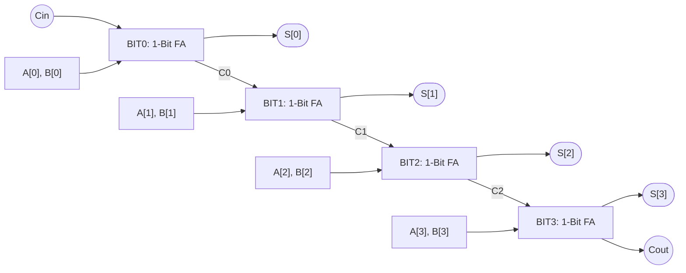
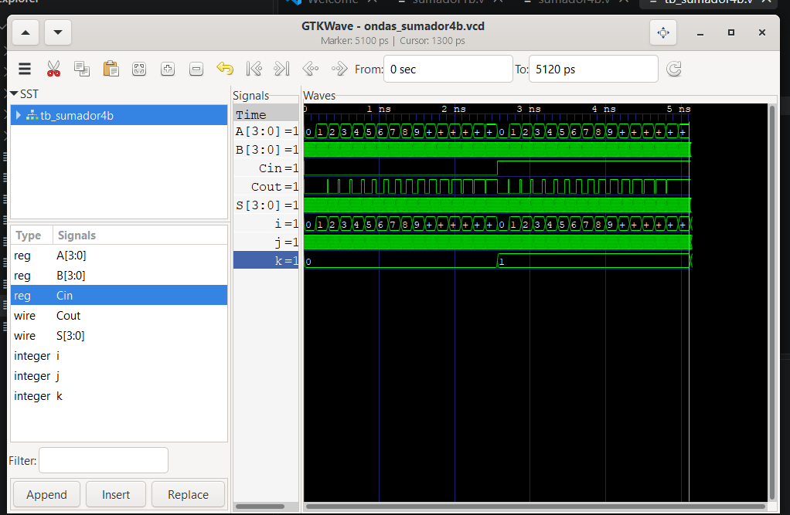
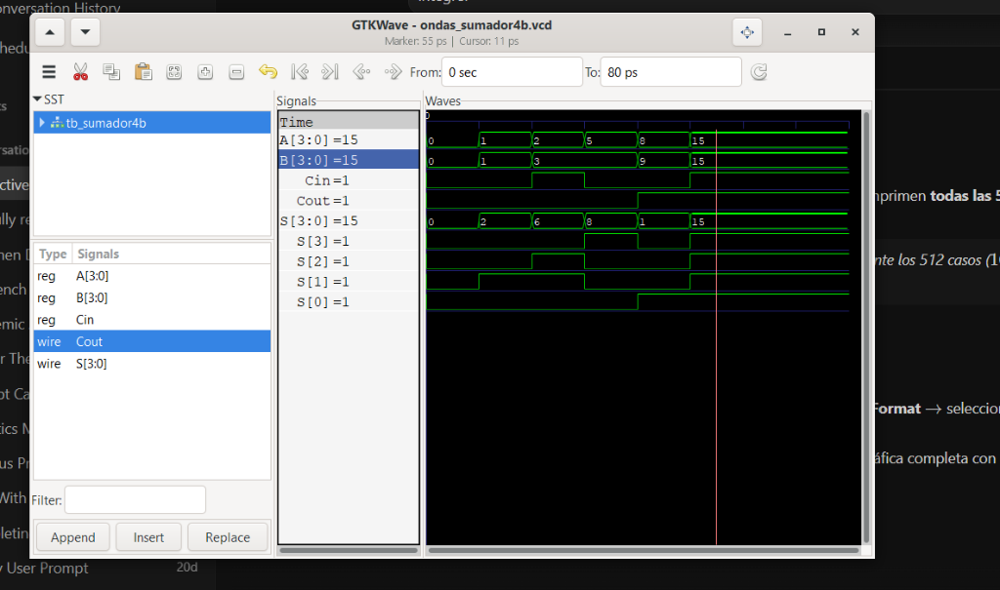

# Laboratorio 02: Sumador de 4 Bits mediante Instanciación (Lógica Combinacional)

**Asignatura:** Técnicas Digitales  
**Institución:** Universidad ECCI  
**Periodo:** 2026-II  
**Integrantes:**
* Diego Pineda
* Sergio Moyano
* Andrés Mejía

---

## 1. Objetivos de Aprendizaje
* Diseñar e implementar un sumador binario de 4 bits con acarreo en cascada (*Ripple Carry Adder*) en lenguaje de descripción de hardware (Verilog).
* Aplicar el concepto de **diseño jerárquico y estructural mediante instanciación**, reutilizando un submódulo sumador completo de 1 bit (*Full Adder*).
* Desarrollar un banco de pruebas (*Testbench*) exhaustivo y automatizado para verificar el 100% de los casos posibles ($512$ combinaciones) en un entorno de simulación (Icarus Verilog + GTKWave).
* Sintetizar, asignar pines e implementar físicamente el diseño en la tarjeta de desarrollo FPGA Intel Cyclone IV / MAX 10 mediante Intel Quartus Prime.

---

## 2. Fundamento Teórico y Arquitectura

### 2.1 Sumador Completo de 1 Bit (*Full Adder*)
El bloque elemental de este laboratorio es el sumador completo de 1 bit, el cual toma tres entradas binarias ($A$, $B$ y el acarreo de entrada $C_{in}$) y genera dos salidas ($S$ y el acarreo de salida $C_{out}$).

* **Ecuación de la Suma ($S$):**
  $$S = A \oplus B \oplus C_{in}$$
* **Ecuación del Acarreo de Salida ($C_{out}$):**
  $$C_{out} = (A \cdot B) + (A \cdot C_{in}) + (B \cdot C_{in})$$

### 2.2 Sumador de 4 Bits en Cascada (*Ripple Carry Adder*)
Para sumar dos números binarios de 4 bits ($A[3:0]$ y $B[3:0]$), se interconectan cuatro sumadores de 1 bit en serie. El bit de acarreo de salida ($C_{out}$) de cada etapa actúa como el acarreo de entrada ($C_{in}$) de la etapa siguiente:



* **Instanciación:** En lugar de describir la suma de forma conductual (`assign S = A + B`), se instanció físicamente el componente `sumador1b` cuatro veces (`BIT0`, `BIT1`, `BIT2`, `BIT3`), conectando sus puertos mediante cables internos (`wire C0, C1, C2`).

---

## 3. Estructura del Repositorio

El proyecto se encuentra organizado de la siguiente manera:

```text
lab02/
├── img/
│   └── simulacion_gtkwave.png      # Captura de la verificación exhaustiva
├── src/
│   ├── sumador1b.v                 # Módulo base: Sumador completo de 1 bit
│   └── sumador4b.v                 # Módulo principal: Top-level de 4 bits instanciado
├── tb/
│   └── tb_sumador4b.v              # Banco de pruebas (Testbench 512 casos)
├── .gitignore                      # Filtro para archivos temporales de Quartus/Icarus
└── README.md                       # Informe de laboratorio
```

---

## 4. Descripción de Hardware (Código Verilog)

### 4.1 Submódulo Base: `src/sumador1b.v`
Describe el sumador de 1 bit empleando primitivas lógicas de hardware (`xor`, `and`, `or`):

```verilog
`timescale 1ns / 1ps

module sumador1b (
    input  wire A,
    input  wire B,
    input  wire Cin,
    output wire S,
    output wire Cout
);
    wire xor1;
    wire and1, and2, and3;

    // Lógica de suma
    xor (xor1, A, B);
    xor (S,    xor1, Cin);

    // Lógica de acarreo
    and (and1, A, B);
    and (and2, A, Cin);
    and (and3, B, Cin);
    or  (Cout, and1, and2, and3);

endmodule
```

### 4.2 Módulo Principal (Top-Level): `src/sumador4b.v`
Instancia cuatro veces el submódulo `sumador1b` y realiza el encadenamiento de los acarreos:

```verilog
`timescale 1ns / 1ps

module sumador4b (
    input  wire [3:0] A,
    input  wire [3:0] B,
    input  wire       Cin,
    output wire [3:0] S,
    output wire       Cout
);
    wire C0, C1, C2; // Acarreos intermedios

    sumador1b BIT0 (
        .A(A[0]), .B(B[0]), .Cin(Cin),
        .S(S[0]), .Cout(C0)
    );

    sumador1b BIT1 (
        .A(A[1]), .B(B[1]), .Cin(C0),
        .S(S[1]), .Cout(C1)
    );

    sumador1b BIT2 (
        .A(A[2]), .B(B[2]), .Cin(C1),
        .S(S[2]), .Cout(C2)
    );

    sumador1b BIT3 (
        .A(A[3]), .B(B[3]), .Cin(C2),
        .S(S[3]), .Cout(Cout)
    );

endmodule
```

---

## 5. Simulación y Verificación Exhaustiva

Para la verificación funcional del circuito, se desarrolló un testbench (`tb/tb_sumador4b.v`) que utiliza tres variables contadoras de tipo `integer` dentro de bucles `for` anidados. Esto permitió evaluar automáticamente el **100% del espacio de combinaciones posibles**:
$$\text{Total Casos} = 2 (\text{para } C_{in}) \times 16 (\text{para } A) \times 16 (\text{para } B) = \mathbf{512 \text{ combinaciones}}$$

Cada combinación se sostuvo durante $10\,\text{ps}$, logrando un tiempo total de simulación exacto de **$5120\,\text{ps}$**.

### 5.1 Vista Panorámica del Espacio Completo (512 Casos - 5120 ps)

Se realizó un barrido exhaustivo de las 512 combinaciones posibles, manteniendo cada estado durante $10\,\text{ps}$:



* **`Cin`:** Se evidencia la división temporal en dos bloques: los primeros $2560\,\text{ps}$ corresponden a $C_{in} = 0$, y de $2560\,\text{ps}$ a $5120\,\text{ps}$ a $C_{in} = 1$.
* **`A[3:0]` y `B[3:0]`:** La entrada $A$ incrementa de $0$ a $15$, y por cada valor de $A$, la entrada $B$ recorre todas las combinaciones posibles de $0$ a $15$.

### 5.2 Vista en Detalle de Casos Representativos (Zoom In)

Para corroborar la exactitud matemática y la propagación de acarreos a nivel de compuertas, se realizó un acercamiento sobre estados de prueba específicos, visualizando las señales en formato decimal junto con el desglose bit a bit del bus de salida (`S[3]`, `S[2]`, `S[1]`, `S[0]`):



#### Análisis de Casos Observados:
1. **$A=0, B=0, C_{in}=0 \implies S=0, C_{out}=0$:** Todas las líneas de salida permanecen en nivel bajo (`0000`).
2. **$A=1, B=1, C_{in}=0 \implies S=2, C_{out}=0$:** El bus de suma marca $2$ en decimal; a nivel de bits se observa únicamente `S[1] = 1` y `S[0] = 0` (`0010`).
3. **$A=2, B=3, C_{in}=1 \implies S=6, C_{out}=0$:** Suma con acarreo de entrada activo: $2 + 3 + 1 = 6$. Se activan `S[2] = 1` y `S[1] = 1` (`0110`).
4. **$A=5, B=3, C_{in}=0 \implies S=8, C_{out}=0$:** Se activa únicamente el bit más significativo de la suma `S[3] = 1` (`1000`).
5. **$A=8, B=9, C_{in}=0 \implies S=1, C_{out}=1$ (Desbordamiento / Carry Out):**
   * Operación matemática: $8 + 9 = 17_{10} = 10001_2$.
   * Como la suma supera la capacidad de 4 bits ($15$), el resultado en el bus de 4 bits es $S = 1$ (`S[0] = 1`), y se activa en nivel alto la bandera de acarreo de salida **`Cout = 1`**, comprobando el funcionamiento perfecto del *Ripple Carry*.

---

## 6. Implementación en Tarjeta FPGA

El diseño fue sintetizado para la tarjeta FPGA utilizando **Intel Quartus Prime Lite**.

### Asignación de Pines Físicos (DE10-Lite - 10M50DAF484C7G)
| Señal HDL | Periférico Físico | Pin FPGA | Descripción |
| :---: | :---: | :---: | :--- |
| `A[0]` | SW[0] | `PIN_C10` | Bit 0 del primer sumando |
| `A[1]` | SW[1] | `PIN_C11` | Bit 1 del primer sumando |
| `A[2]` | SW[2] | `PIN_D12` | Bit 2 del primer sumando |
| `A[3]` | SW[3] | `PIN_C12` | Bit 3 del primer sumando |
| `B[0]` | SW[4] | `PIN_A12` | Bit 0 del segundo sumando |
| `B[1]` | SW[5] | `PIN_B12` | Bit 1 del segundo sumando |
| `B[2]` | SW[6] | `PIN_A13` | Bit 2 del segundo sumando |
| `B[3]` | SW[7] | `PIN_A14` | Bit 3 del segundo sumando |
| `Cin`  | SW[8] | `PIN_B14` | Acarreo de entrada inicial |
| `S[0]` | LEDR[0] | `PIN_A8` | Bit 0 del resultado de la suma |
| `S[1]` | LEDR[1] | `PIN_A9` | Bit 1 del resultado de la suma |
| `S[2]` | LEDR[2] | `PIN_A10` | Bit 2 del resultado de la suma |
| `S[3]` | LEDR[3] | `PIN_B10` | Bit 3 del resultado de la suma |
| `Cout` | LEDR[4] | `PIN_D13` | Acarreo final de salida / Overflow |

---

## 7. Demostración en Video del Funcionamiento Físico

En el siguiente video se evidencia el funcionamiento en hardware real del sumador de 4 bits sobre la tarjeta FPGA, comprobando operaciones sin desbordamiento (ej. $5 + 3 = 8$) y operaciones con activación del acarreo final (ej. $15 + 1 = 16 \implies S=0, C_{out}=1$):

<!-- ESPACIO PARA EL VIDEO: Arrastra tu archivo .mp4 aquí en el editor de GitHub o pega el enlace de Drive/YouTube -->

> 📹 **Video de demostración:**
> 
> *(Arrastra y suelta tu archivo de video .mp4 aquí en GitHub para que aparezca el reproductor interactivo)*

---

## 8. Conclusiones
* Se comprobó la efectividad del modelado estructural en Verilog para crear circuitos complejos a partir de bloques funcionales más sencillos, favoreciendo la modularidad y el orden del código.
* La implementación del banco de pruebas mediante bucles `for` anidados con variables `integer` garantizó una verificación formal y rigurosa sobre los 512 casos posibles, eliminando errores humanos de prueba manual.
* Se validó físicamente el concepto de *Ripple Carry*, observando el comportamiento instantáneo de las compuertas lógicas frente a la manipulación de los interruptores y visualizando los acarreos en los LEDs indicadores.
