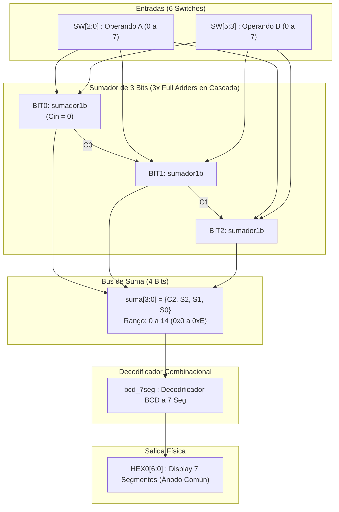
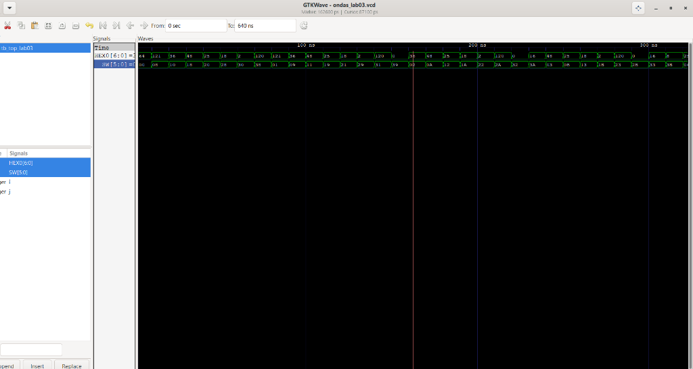

# Laboratorio 03: Implementación de Display de 7 Segmentos y Sumador de 3 Bits

**Asignatura:** Técnicas Digitales  
**Institución:** Universidad ECCI  
**Periodo:** 2026-II  
**Integrantes:**
* Diego Pineda
* Sergio Moyano
* Andrés Mejía

---

## 1. Objetivos del Laboratorio
* Diseñar e implementar un decodificador combinacional de código binario/BCD a display de 7 segmentos de ánodo común en lenguaje de descripción de hardware (Verilog).
* Integrar un sumador binario de 3 bits con acarreo en cascada (*Ripple Carry Adder*) estructurado jerárquicamente a partir de tres instancias de sumadores completos de 1 bit (*Full Adders*).
* Visualizar en tiempo real el resultado de la suma de dos números de 3 bits ($0$ a $7$) en formato hexadecimal ($0$ a $E$) sobre el display de 7 segmentos `HEX0` de la tarjeta de desarrollo FPGA.
* Validar el diseño exhaustivamente mediante un banco de pruebas (*Testbench*) que evalúe el 100% de las combinaciones posibles ($8 \times 8 = 64$ casos) en Icarus Verilog y GTKWave.
* Sintetizar, asignar pines físicos y programar la tarjeta de desarrollo FPGA Intel MAX 10 (DE10-Lite) mediante Intel Quartus Prime.

---

## 2. Fundamento Teórico

### 2.1 Display de 7 Segmentos (Configuración Ánodo Común)
Un display de 7 segmentos es un componente optoelectrónico compuesto por siete diodos emisores de luz (LEDs) etiquetados de la `a` a la `g`. En la tarjeta **DE10-Lite**, los displays están configurados en **ánodo común**:
* Los ánodos de todos los segmentos están conectados internamente a la línea de alimentación ($+V_{CC}$).
* Por lo tanto, cada segmento se enciende suministrando un **nivel lógico bajo (`0`)** a su cátodo correspondiente (**lógica activa en bajo**).
* Un **nivel lógico alto (`1`)** apaga el segmento.

```
       a
     -----
    |     |
  f |     | b
    |     |
     --g--
    |     |
  e |     | c
    |     |
     -----
       d
```

### 2.2 Tabla de Verdad del Decodificador Binario a 7 Segmentos (0 a F)
El bus de salida de 7 bits se define en el orden estándar **`{g, f, e, d, c, b, a}`**:

| Dígito | Binario | `g` | `f` | `e` | `d` | `c` | `b` | `a` | Vector `{g,f,e,d,c,b,a}` | Segmentos Encendidos |
| :---: | :---: | :---: | :---: | :---: | :---: | :---: | :---: | :---: | :---: | :--- |
| **0** | `0000` | 1 | 0 | 0 | 0 | 0 | 0 | 0 | `7'b1000000` | a, b, c, d, e, f |
| **1** | `0001` | 1 | 1 | 1 | 1 | 0 | 0 | 1 | `7'b1111001` | b, c |
| **2** | `0010` | 0 | 1 | 0 | 0 | 1 | 0 | 0 | `7'b0100100` | a, b, d, e, g |
| **3** | `0011` | 0 | 1 | 1 | 0 | 0 | 0 | 0 | `7'b0110000` | a, b, c, d, g |
| **4** | `0100` | 0 | 0 | 1 | 1 | 0 | 0 | 1 | `7'b0011001` | b, c, f, g |
| **5** | `0101` | 0 | 0 | 1 | 0 | 0 | 1 | 0 | `7'b0010010` | a, c, d, f, g |
| **6** | `0110` | 0 | 0 | 0 | 0 | 0 | 1 | 0 | `7'b0000010` | a, c, d, e, f, g |
| **7** | `0111` | 1 | 1 | 1 | 1 | 0 | 0 | 0 | `7'b1111000` | a, b, c |
| **8** | `1000` | 0 | 0 | 0 | 0 | 0 | 0 | 0 | `7'b0000000` | Todos (a,b,c,d,e,f,g) |
| **9** | `1001` | 0 | 0 | 1 | 0 | 0 | 0 | 0 | `7'b0010000` | a, b, c, d, f, g |
| **A** | `1010` | 0 | 0 | 0 | 1 | 0 | 0 | 0 | `7'b0001000` | a, b, c, e, f, g |
| **B** | `1011` | 0 | 0 | 0 | 0 | 0 | 1 | 1 | `7'b0000011` | c, d, e, f, g (minúscula `b`) |
| **C** | `1100` | 1 | 0 | 0 | 0 | 1 | 1 | 0 | `7'b1000110` | a, d, e, f |
| **D** | `1101` | 0 | 1 | 0 | 0 | 0 | 0 | 1 | `7'b0100001` | b, c, d, e, g (minúscula `d`) |
| **E** | `1110` | 0 | 0 | 0 | 0 | 1 | 1 | 0 | `7'b0000110` | a, d, e, f, g |
| **F** | `1111` | 0 | 0 | 0 | 1 | 1 | 1 | 0 | `7'b0001110` | a, e, f, g |

---

## 3. Arquitectura Modular del Sistema

El sistema implementa una arquitectura estructural jerárquica:



---

## 4. Estructura del Repositorio

```text
lab03/
├── .gitignore                      # Filtro de archivos de simulación y temporales Quartus
├── README.md                       # Informe técnico del laboratorio
├── img/
│   └── simulacion_gtkwave.png      # Captura de verificación exhaustiva en GTKWave
├── video/
│   └── demostracion_fpga.mp4       # Video demostrativo de la FPGA en funcionamiento
├── src/
│   ├── sumador1b.v                 # Sumador de 1 bit con primitivas lógicas
│   ├── bcd_7seg.v                  # Decodificador hexadecimal a 7 segmentos
│   └── top_lab03.v                 # Módulo principal top-level
└── tb/
    └── tb_top_lab03.v              # Banco de pruebas (Testbench 64 casos)
```

---

## 5. Descripción de Hardware (Código Verilog)

### 5.1 Submódulo Sumador de 1 Bit (`src/sumador1b.v`)
Implementado con compuertas lógicas primitivas:

```verilog
`timescale 1ns / 1ps

module sumador1b (
    input  wire A,
    input  wire B,
    input  wire Cin,
    output wire S,
    output wire Cout
);
    wire xor1;
    wire and1, and2, and3;

    // Suma: S = A ^ B ^ Cin
    xor (xor1, A, B);
    xor (S,    xor1, Cin);

    // Acarreo: Cout = (A & B) | (A & Cin) | (B & Cin)
    and (and1, A, B);
    and (and2, A, Cin);
    and (and3, B, Cin);
    or  (Cout, and1, and2, and3);

endmodule
```

### 5.2 Submódulo Decodificador a 7 Segmentos (`src/bcd_7seg.v`)
Traduce valores binarios de 4 bits ($0$ a $F$) a señales activas en bajo para display de ánodo común:

```verilog
`timescale 1ns / 1ps

module bcd_7seg (
    input  wire [3:0] BCD,
    output reg  [6:0] SEG
);
    always @(*) begin
        case (BCD)
            4'h0: SEG = 7'b1000000; // 0
            4'h1: SEG = 7'b1111001; // 1
            4'h2: SEG = 7'b0100100; // 2
            4'h3: SEG = 7'b0110000; // 3
            4'h4: SEG = 7'b0011001; // 4
            4'h5: SEG = 7'b0010010; // 5
            4'h6: SEG = 7'b0000010; // 6
            4'h7: SEG = 7'b1111000; // 7
            4'h8: SEG = 7'b0000000; // 8
            4'h9: SEG = 7'b0010000; // 9
            4'hA: SEG = 7'b0001000; // A
            4'hB: SEG = 7'b0000011; // b
            4'hC: SEG = 7'b1000110; // C
            4'hD: SEG = 7'b0100001; // d
            4'hE: SEG = 7'b0000110; // E
            4'hF: SEG = 7'b0001110; // F
            default: SEG = 7'b1111111; // Apagado
        endcase
    end
endmodule
```

### 5.3 Módulo Top-Level (`src/top_lab03.v`)
Integra las 3 instancias del sumador y el decodificador conectando a los switches y al display:

```verilog
`timescale 1ns / 1ps

module top_lab03 (
    input  wire [5:0] SW,    // SW[2:0]=A, SW[5:3]=B
    output wire [6:0] HEX0  // Display 7 segmentos
);

    wire [3:0] suma;
    wire C0, C1, C2;

    // Sumador de 3 bits con acarreo en cascada
    sumador1b BIT0 (
        .A(SW[0]), .B(SW[3]), .Cin(1'b0),
        .S(suma[0]), .Cout(C0)
    );

    sumador1b BIT1 (
        .A(SW[1]), .B(SW[4]), .Cin(C0),
        .S(suma[1]), .Cout(C1)
    );

    sumador1b BIT2 (
        .A(SW[2]), .B(SW[5]), .Cin(C1),
        .S(suma[2]), .Cout(C2)
    );

    assign suma[3] = C2;

    // Decodificador de 7 segmentos
    bcd_7seg decodificador (
        .BCD(suma),
        .SEG(HEX0)
    );

endmodule
```

---

## 6. Simulación y Verificación en GTKWave

Se implementó un banco de pruebas (`tb/tb_top_lab03.v`) que mediante dos bucles `for` anidados con variables `integer` genera exhaustivamente las **64 combinaciones posibles** ($8 \times 8$). Cada estado se sostiene durante $10\,\text{ns}$ para permitir la propagación de las compuertas, totalizando una simulación de **$640\,\text{ns}$**.

### 6.1 Evidencia de Simulación


### 6.2 Casos de Prueba Verificados
* **Suma baja:** $A = 2$ (`010`), $B = 3$ (`011`) $\implies \text{Suma} = 5$ (`0101`). `HEX0 = 7'b0010010` (dígito **5** encendido).
* **Transición a Hexadecimal:** $A = 5$ (`101`), $B = 7$ (`111`) $\implies \text{Suma} = 12$ (`1100` = `0xC`). `HEX0 = 7'b1000110` (letra **C** encendida).
* **Suma máxima:** $A = 7$ (`111`), $B = 7$ (`111`) $\implies \text{Suma} = 14$ (`1110` = `0xE`). `HEX0 = 7'b0000110` (letra **E** encendida).

---

## 7. Implementación en Tarjeta FPGA (DE10-Lite)

El proyecto fue compilado y sintetizado en **Intel Quartus Prime** para el dispositivo **MAX 10 (10M50DAF484C7G)**.

### Asignación de Pines Físicos
| Señal HDL | Periférico | Pin FPGA | Función |
| :---: | :---: | :---: | :--- |
| `SW[0]` | Switch 0 | `PIN_C10` | Bit 0 del Operando A |
| `SW[1]` | Switch 1 | `PIN_C11` | Bit 1 del Operando A |
| `SW[2]` | Switch 2 | `PIN_D12` | Bit 2 del Operando A |
| `SW[3]` | Switch 3 | `PIN_C12` | Bit 0 del Operando B |
| `SW[4]` | Switch 4 | `PIN_A12` | Bit 1 del Operando B |
| `SW[5]` | Switch 5 | `PIN_B12` | Bit 2 del Operando B |
| `HEX0[0]` | Display 0 (Seg a) | `PIN_C14` | Segmento superior |
| `HEX0[1]` | Display 0 (Seg b) | `PIN_E15` | Segmento lateral superior derecho |
| `HEX0[2]` | Display 0 (Seg c) | `PIN_C15` | Segmento lateral inferior derecho |
| `HEX0[3]` | Display 0 (Seg d) | `PIN_C16` | Segmento inferior |
| `HEX0[4]` | Display 0 (Seg e) | `PIN_E16` | Segmento lateral inferior izquierdo |
| `HEX0[5]` | Display 0 (Seg f) | `PIN_D17` | Segmento lateral superior izquierdo |
| `HEX0[6]` | Display 0 (Seg g) | `PIN_C17` | Segmento central |

---

## 8. Demostración en Video del Funcionamiento Físico

En el video demostrativo se evidencia el funcionamiento en hardware real sobre la tarjeta FPGA DE10-Lite, comprobando las operaciones en formato decimal y los dígitos hexadecimales ($A, b, C, d, E$):

> 📹 **Registro Audiovisual de la Prueba:**  
> El video de la prueba en hardware se encuentra incluido y versionado directamente en el repositorio:  
> 📥 **[Clic aquí para ver o descargar el video: `demostracion_fpga.mp4`](video/demostracion_fpga.mp4)**

---

## 9. Conclusiones
* Se consolidó la metodología de diseño jerárquico al integrar submódulos de diferente naturaleza (operaciones aritméticas binarias y decodificación de visualización) en un módulo de nivel superior.
* La comprensión de la configuración de ánodo común fue crucial para modelar correctamente la lógica activa en bajo en Verilog, asegurando que los segmentos correctos se enciendan al recibir ceros lógicos.
* La verificación mediante simulación exhaustiva previa a la programación en la tarjeta FPGA redujo a cero los errores de diseño, confirmando el correcto funcionamiento en los 64 casos del espacio muestral.
