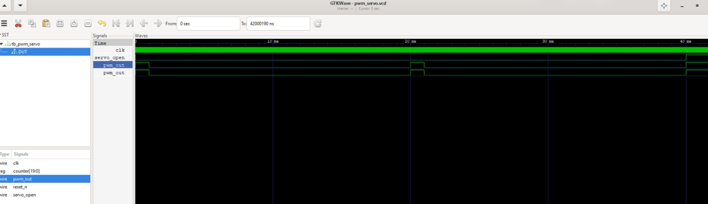

# Laboratorio 06: Caja Fuerte Digital con Máquina de Estados Finitos (FSM) y Servomotor

**Universidad ECCI**  
**Facultad de Ingeniería**  
**Técnicas Digitales - Grupo 1, Equipo 4**

**Integrantes:**
- Diego Pineda
- Sergio Daniel Moyano
- Andrés Mejía

---

## 1. Introducción y Objetivos

El objetivo de esta práctica es diseñar e implementar en hardware (FPGA **DE1-SoC**, Cyclone V) una **caja fuerte digital** controlada por una Máquina de Estados Finitos tipo Moore de 7 estados. El sistema permite ingresar una clave de **3 dígitos hexadecimales** mediante los switches y el botón `KEY[0]` de la tarjeta, controla un **servomotor** mediante señal PWM para simular la apertura mecánica de la caja y dispone de un mecanismo de **bloqueo automático** tras 3 intentos fallidos consecutivos.

---

## 2. Fotografías del Hardware

| Montaje de la Caja Fuerte | FPGA DE1-SoC |
|:---:|:---:|
|  |  |

---

## 3. Arquitectura del Sistema

```
  CLOCK_50 ──────────────────────────────────────────────┐
                                                         │
  KEY[0] ──► [ sync ] ──► [ debounce ] ──► enter_pulse  │
                                                         ▼
  KEY[1] ──► reset_n ─────────────────► [ fsm_caja_fuerte ]
                                                 │
  SW[3:0] ──────────────────────────────────────►│
                                                 │
                              ┌──────────────────┼──────────────────┐
                              ▼                  ▼                  ▼
                       [ pwm_servo ]    [ decoder_7seg ]   servo_open / LEDs
                              │                  │
                         GPIO_0[0]        HEX5..HEX0
                        (servo PWM)
```

| Módulo | Archivo | Función |
|--------|---------|---------|
| Top-level | `CajaFuerte.v` | Conecta todos los submódulos y asigna pines DE1-SoC |
| FSM Moore | `fsm_caja_fuerte.v` | Control principal: 7 estados, 3 bloques `always` |
| Anti-rebote | `debounce.v` | Elimina rebotes del botón (20 ms por conteo) |
| Sincronizador | `sync.v` | Doble flip-flop para señal asíncrona `KEY[0]` |
| Servo PWM | `pwm_servo.v` | Genera señal PWM 50 Hz: 1 ms cerrado, 2 ms abierto |
| Displays | `decoder_7seg.v` | Decodifica el modo de display a 7 segmentos activos en bajo |

---

## 4. Diagrama y Tabla de Estados (FSM Moore de 7 estados)

```
                              reset_n
                                │
                                ▼
                          ┌──────────┐
               ┌──────────│ S_INICIO │◄─────────────────────────────┐
               │  enter   │  (000)   │                              │
               │  pulse   └──────────┘                              │
               │                                              master_reset
               ▼                                                     │
          ┌──────────┐                                               │
          │  S_CAP1  │  (muestra dígito 1 en HEX0)                  │
          │  (001)   │                                               │
          └────┬─────┘                                               │
         enter │                                                     │
               ▼                                                     │
          ┌──────────┐                                               │
          │  S_CAP2  │  (muestra dígito 2 en HEX0)                  │
          │  (010)   │                                               │
          └────┬─────┘                                               │
         enter │                                                     │
               ▼                                                     │
          ┌──────────┐    clave OK    ┌──────────────┐               │
          │  S_VERIF │───────────────►│  S_ABIERTO   │───────────────┘
          │  (011)   │                │    (100)     │
          └────┬─────┘                └──────────────┘
      clave    │  (servo abre, LED verde, display AccESO)
      errónea  │
               ▼
          ┌──────────┐    attempts > 0     S_INICIO
          │  S_ERROR │──────────────────────────────► (vuelve a intentar)
          │  (101)   │  (LED rojo, display Int. n)
          │          │    attempts == 0
          └──────────┘──────────────────────────────► S_BLOQUEO
                                                           │
                                                     ┌─────┴────┐
                                                     │ S_BLOQUEO│
                                                     │  (110)   │
                                                     └──────────┘
                                               (LED rojo, display bLOquE)
                                               Solo sale con reset_n
```

| Estado | Código | Servo | LED Verde | LED Rojo | Display |
|--------|--------|-------|-----------|----------|---------|
| `S_INICIO` | `000` | ✗ | ✗ | ✗ | `------` |
| `S_CAP1` | `001` | ✗ | ✗ | ✗ | Dígito 1 |
| `S_CAP2` | `010` | ✗ | ✗ | ✗ | Dígito 2 |
| `S_VERIF` | `011` | ✗ | ✗ | ✗ | `------` |
| `S_ABIERTO` | `100` | ✓ | ✓ | ✗ | `AccESO` |
| `S_ERROR` | `101` | ✗ | ✗ | ✓ | `Int. n` |
| `S_BLOQUEO` | `110` | ✗ | ✗ | ✓ | `bLOquE` |

> [!IMPORTANT]
> **Clave predeterminada:** `3` → `A` → `7` (parametrizable en `CajaFuerte.v`)  
> En `S_ERROR`, el sistema espera **un pulso adicional de `KEY[0]`** para reconocer el error antes de volver a `S_INICIO`. Si ya no quedan intentos, ese mismo pulso lleva al sistema a `S_BLOQUEO`.

---

## 5. Señal PWM del Servomotor

| Estado servo | Ancho de pulso | Posición |
|---|---|---|
| Cerrado (`servo_open = 0`) | 1 ms cada 20 ms (5 % duty cycle) | 0° |
| Abierto (`servo_open = 1`) | 2 ms cada 20 ms (10 % duty cycle) | ~90° |

---

## 6. Asignación de Pines (DE1-SoC — Cyclone V `5CSEMA5F31C6`)

| Señal | Descripción | Pin FPGA |
|-------|-------------|----------|
| `CLOCK_50` | Reloj 50 MHz | `PIN_AF14` |
| `KEY[0]` | Confirmar dígito / reconocer error (activo en bajo) | `PIN_AA14` |
| `KEY[1]` | Reset del sistema (activo en bajo) | `PIN_AA15` |
| `SW[0]` | Bit 0 del dígito a ingresar | `PIN_AB12` |
| `SW[1]` | Bit 1 del dígito a ingresar | `PIN_AC12` |
| `SW[2]` | Bit 2 del dígito a ingresar | `PIN_AF9` |
| `SW[3]` | Bit 3 del dígito a ingresar | `PIN_AF10` |
| `HEX0[6:0]` | Display 0 (dígito actual / unidades mensaje) | Banco HEX0 |
| `HEX1–HEX5` | Displays del mensaje de estado | Banco HEX1–HEX5 |
| `GPIO_0[0]` | Señal PWM al servomotor | `PIN_AB22` |
| `GPIO_0[1]` | LED Verde externo (acceso concedido) | `PIN_AC15` |
| `GPIO_0[2]` | LED Rojo externo (error / bloqueo) | `PIN_AD17` |

---

## 7. Simulación y Verificación

La FSM fue verificada con **Icarus Verilog**:

```bash
# Compilar y simular la FSM
iverilog -g2005 -o caja_sim.vvp src/fsm_caja_fuerte.v tb/tb_caja_fuerte.v
vvp caja_sim.vvp

# Compilar y simular el PWM
iverilog -g2005 -o pwm_sim.vvp src/pwm_servo.v tb/tb_pwm_servo.v
vvp pwm_sim.vvp
```

Resultado de simulación (5 pruebas, todas correctas):

```
PRUEBA 1: CLAVE CORRECTA
  CORRECTO: CAJA ABIERTA
PRUEBA 2: PRIMER ERROR
  CORRECTO: QUEDAN 2 INTENTOS
PRUEBA 3: SEGUNDO ERROR
  CORRECTO: QUEDA 1 INTENTO
PRUEBA 4: TERCER ERROR -> BLOQUEO
  CORRECTO: CAJA BLOQUEADA
PRUEBA 5: CLAVE CORRECTA EN ESTADO BLOQUEADO (no debe abrir)
  CORRECTO: PERMANECE BLOQUEADA
FIN DE LAS PRUEBAS
```

> [!NOTE]
> El testbench corregido incluye la tarea `reconocer_error()` que simula el pulso adicional de `KEY[0]` necesario para salir del estado `S_ERROR`. Esto refleja el comportamiento real del hardware.

---

## 8. Demostración en Video del Funcionamiento Físico

> **Video incluido en el repositorio:**  
> Puedes reproducir o descargar el archivo de video alojado en la carpeta `video/`:  
> **[▶ Ver video de la demostración en la FPGA](video/demostracion_fpga.mp4)**

---

## 9. Procedimiento para Cargar a la FPGA

1. Abrir **Quartus Prime Lite Edition**
2. **File → Open Project...** y cargar el `.qpf` del proyecto
3. Compilar con **Ctrl+L** (Start Compilation)
4. **Tools → Programmer → Hardware Setup...** seleccionar `DE-SoC` o `USB-Blaster`
5. Cargar `output_files/CajaFuerte.sof` y presionar **Start**

---

## 10. Conclusiones

- Se implementó exitosamente una FSM Moore de 7 estados que modela el comportamiento completo de una caja fuerte digital con verificación de clave hexadecimal de 3 dígitos.
- El uso del sincronizador de doble flip-flop (`sync.v`) y el módulo de antirrebote (`debounce.v`) garantiza que los pulsos de entrada sean limpios y de exactamente un ciclo de reloj, evitando transiciones de estado no deseadas.
- El módulo PWM genera la señal de control estándar para servomotores (periodo de 20 ms), permitiendo controlar la posición angular del servo con precisión.
- La simulación con 5 casos de prueba verificó el comportamiento correcto en todos los escenarios: apertura exitosa, descuento de intentos tras error, bloqueo permanente y seguridad ante intentos en estado bloqueado.
